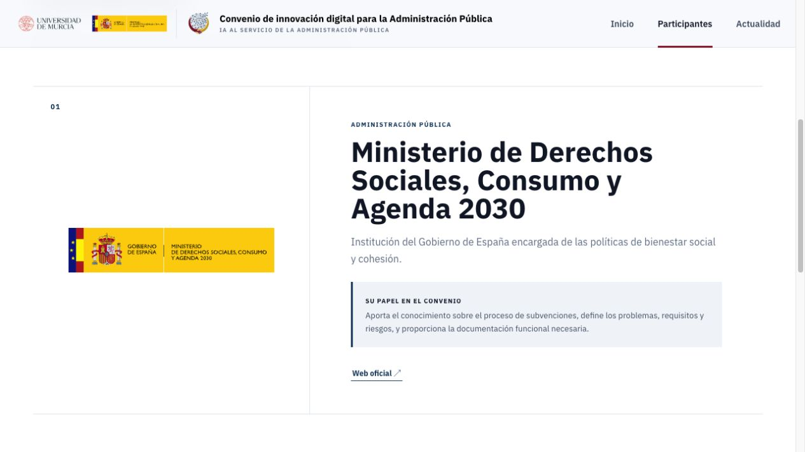

# Innovación pública

[](https://github.com/CyberDataLab/convenio-mdsca-web/actions/workflows/main.yml)
[](https://react.dev/)
[](https://www.typescriptlang.org/)
[](https://vite.dev/)

Web del **convenio de innovación digital para la Administración Pública** entre el Ministerio de Derechos Sociales, Consumo y Agenda 2030 y la Universidad de Murcia. Presenta la investigación sobre el uso de la IA en la gestión de subvenciones públicas, las entidades participantes y la actualidad del proyecto.

**[Visitar innovacionpublica.es](https://innovacionpublica.es/)** · [Guía de despliegue](docs/DEPLOYMENT.md) · [Contacto CyberDataLab](mailto:cyberdatalab@listas.um.es)

## Capturas

| Inicio | Entidades participantes · detalle |
| --- | --- |
| [](docs/images/inicio.jpg) | [](docs/images/participantes.jpg) |

## Desarrollo

Requiere **Node.js 22 (≥22.12)** y npm, en línea con el entorno de GitHub Actions.

```bash
npm ci
npm run dev
```

| Comando | Uso |
| --- | --- |
| `npm run dev` | Servidor de desarrollo con recarga automática. |
| `npm run lint` | Revisión del código con Oxlint. |
| `npm run build` | Comprobación de TypeScript y compilación en `dist/`. |
| `npm run preview` | Vista previa local de la compilación. |

## Contenidos

| Qué editar | Dónde |
| --- | --- |
| Presentación, objetivos y entidades | [`src/content.ts`](src/content.ts) |
| Noticias y su registro | [`src/noticias/`](src/noticias/) |
| Páginas y componentes | [`src/views/`](src/views/) · [`src/components/`](src/components/) |
| Estilos | [`src/App.css`](src/App.css) · [`src/index.css`](src/index.css) |
| Imágenes y logotipos públicos | [`public/`](public/) |
| Originales editables de GIMP | [`design/noticias/`](design/noticias/) |

Las noticias con `published: false` solo se muestran en desarrollo. La navegación usa rutas con `#`, compatibles con GitHub Pages.

## Publicación

1. **Configuración inicial:** en **Settings → Pages**, seleccionar **GitHub Actions** como origen y guardar `innovacionpublica.es` en **Custom domain**.
2. Configurar los DNS del dominio y activar **Enforce HTTPS** cuando GitHub emita el certificado. Los registros necesarios están en la [guía de despliegue](docs/DEPLOYMENT.md).
3. Antes de publicar, ejecutar `npm run lint` y `npm run build`.
4. Subir los cambios a `main`: el workflow **Deploy to GitHub Pages** instala, compila y publica automáticamente.
5. Comprobar que el workflow termina correctamente en **Actions** y revisar **https://innovacionpublica.es/**.

Para repetir el despliegue manualmente: **Actions → Deploy to GitHub Pages → Run workflow → main**.

`node_modules/`, `dist/` y las cachés se generan localmente y están excluidos de Git.
